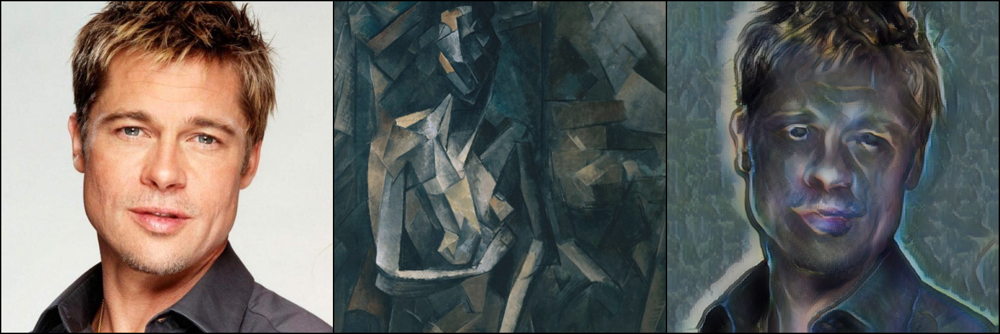

# Arbitrary Neural Style Transfer with AdaIN in PyTorch

An end-to-end PyTorch implementation of **Arbitrary Style Transfer in Real-time with Adaptive Instance Normalization** (Huang & Belongie, ICCV 2017). This project includes a complete training pipeline, command-line inference script with style interpolation, and an interactive Flask web application.

---

## 🎨 Sample Results

| Content & Style 1 (Picasso) | Stylized Output |
| :---: | :---: |
|  | High-fidelity arbitrary artistic style transfer preserving structural details of the content while transferring color palette and brush strokes. |

| Content & Style 2 (Pencil Sketch) | Stylized Output |
| :---: | :---: |
|  | Adaptive Instance Normalization transfers monochrome textures and shading while retaining facial landmarks. |

---

## ✨ Features

- **Real-Time Arbitrary Style Transfer:** Transfer any unseen style onto any content image in real-time using Adaptive Instance Normalization (AdaIN).
- **Flexible Style Trade-off ($\alpha$ interpolation):** Adjust the degree of stylization dynamically from $0.0$ (original content) to $1.0$ (complete stylization) at inference time without re-training.
- **Custom Trained Decoder Included:** Includes pre-trained weights (`experiment/experiment_full/decoder_10.pth`) trained on MS-COCO and WikiArt datasets.
- **Interactive Web App:** User-friendly Flask interface with drag-and-drop file upload, style selection, and instant preview.
- **Robust Training Pipeline:** Complete training script supporting multi-GPU/CUDA, gradient clipping, checkpointing, and safe handling of massive high-resolution images.

---

## 📂 Project Structure

```text
Neural Style Transfer with AdaIN/
├── app.py                      # Flask web application for interactive stylization
├── train.py                    # Training script for the AdaIN decoder
├── test.py                     # CLI inference script (single image & comparison)
├── demo.ipynb                  # Jupyter notebook demo
├── requirements.txt            # Python dependencies
├── .gitignore                  # Git ignore rules for datasets & checkpoints
├── utils/
│   ├── models.py               # VGG-19 Encoder and Decoder network architectures
│   └── utils.py                # AdaIN layer, loss functions, and dataset loaders
├── experiment/
│   └── experiment_full/
│       ├── decoder_10.pth      # Pre-trained AdaIN decoder weights (10 epochs)
│       └── args.txt            # Training configuration and hyperparameters
├── inputs/                     # Sample content and style images
│   ├── content.jpg
│   ├── style1_picasso.jpg
│   └── style2_sketch.png
├── outputs/                    # Generated stylized and side-by-side comparison images
├── templates/
│   └── index.html              # HTML template for the Flask web application
└── static/
    └── uploads/                # Directory for web app uploaded images
```

---

## 🚀 Getting Started

### 1. Clone the Repository
```bash
git clone https://github.com/mewtwo-05/NST-with-AdaIN.git
cd NST-with-AdaIN
```

### 2. Set Up Virtual Environment & Dependencies
```bash
# Create virtual environment
python -m venv .venv

# Activate virtual environment
# Windows (PowerShell):
.\.venv\Scripts\Activate.ps1
# Linux / macOS:
source .venv/bin/activate

# Install dependencies
pip install -r requirements.txt
```

> **Note for CUDA / GPU support:** If you have an NVIDIA GPU, install PyTorch with CUDA support:
> ```bash
> pip install torch torchvision --index-url https://download.pytorch.org/whl/cu121
> ```

### 3. Pre-trained Weights (Included)
Both model weights required for inference and the web app are already included in this repository:
- **VGG-19 Encoder:** `vgg_normalized.pth` (placed in the root directory)
- **Trained AdaIN Decoder:** `experiment/experiment_full/decoder_10.pth`

You can run inference or start the web app right away without downloading external weights!

---

## 💻 Usage

### 1. Command-Line Inference (`test.py`)
Run style transfer on any content and style image pair:

```bash
python test.py --content inputs/content.jpg --style inputs/style1_picasso.jpg --output outputs/result_picasso.png --comparison outputs/comparison_picasso.png
```

#### Adjusting Style Strength ($\alpha$):
To blend content and style, set the `--alpha` flag between `0.0` (pure content) and `1.0` (maximum style):
```bash
python test.py --content inputs/content.jpg --style inputs/style1_picasso.jpg --alpha 0.6 --output outputs/result_picasso_60pct.png
```

### 2. Launch the Web App (`app.py`)
Run the Flask server:
```bash
python app.py
```
Open your browser and navigate to `http://127.0.0.1:5000` to stylize images via the interactive web UI.

### 3. Training from Scratch (`train.py`)
To train your own decoder on MS-COCO (content) and WikiArt (style):
```bash
python train.py --content_dir /path/to/coco --style_dir /path/to/wikiart --vgg vgg_normalized.pth --save_dir experiment/my_experiment --max_epoch 10 --batch_size 8
```

---

## 🧠 Methodology & Theory

AdaIN performs arbitrary style transfer by aligning the mean and variance of content feature representations with those of style feature representations in deep feature space:

$$\text{AdaIN}(x, y) = \sigma(y) \left( \frac{x - \mu(x)}{\sigma(x)} \right) + \mu(y)$$

1. **Feature Extraction:** A pre-trained, fixed VGG-19 network encodes both content image $I_c$ and style image $I_s$ up to layer `relu4_1`.
2. **Adaptive Instance Normalization:** The AdaIN layer shifts the channel-wise normalized content activations to match the channel-wise mean and variance of the style activations.
3. **Reconstruction:** A mirror decoder network reconstructs the stylized image back into the RGB pixel space.
4. **Style Control ($\alpha$):** The target feature is interpolated between original content features and AdaIN stylized features:
   $$T = \alpha \cdot \text{AdaIN}(f(I_c), f(I_s)) + (1 - \alpha) f(I_c)$$

---

## 📜 References
- **AdaIN Paper:** Huang, Xun, and Serge Belongie. *"Arbitrary style transfer in real-time with adaptive instance normalization."* Proceedings of the IEEE International Conference on Computer Vision (ICCV), 2017. [arXiv:1703.06868](https://arxiv.org/abs/1703.06868)
